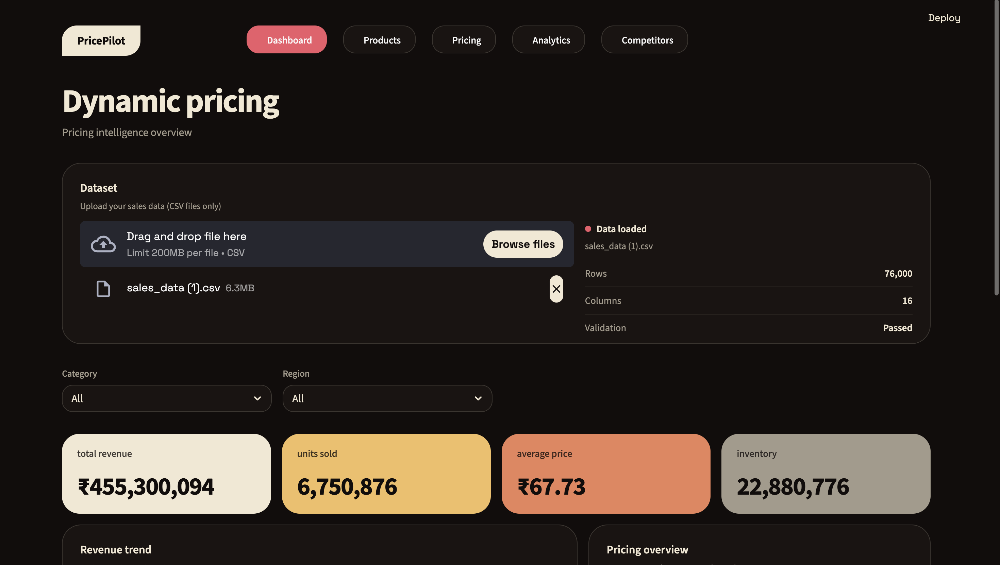
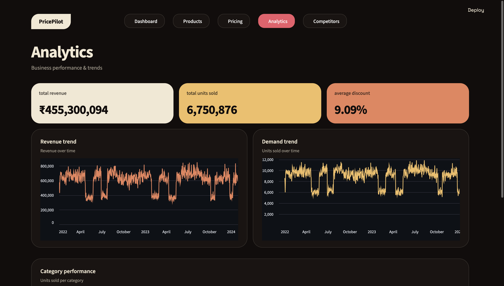
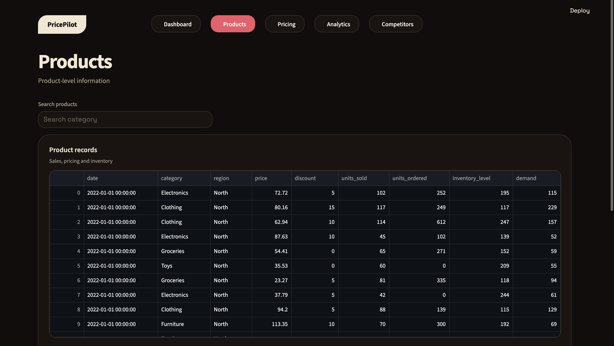
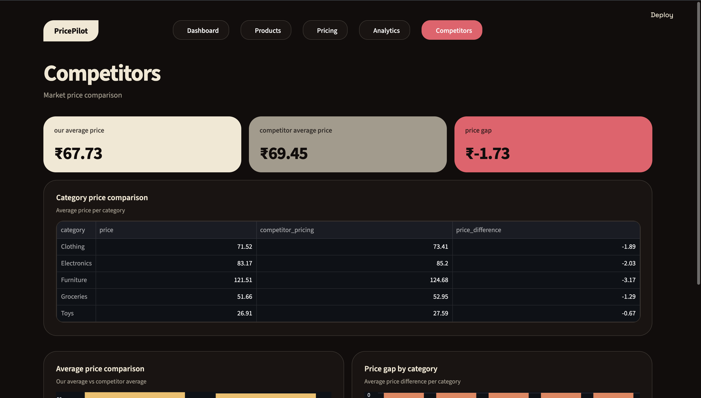

# Dynamic Pricing Strategy Optimizer

An interactive **data-driven pricing dashboard** built with Python and Streamlit to help businesses analyze sales performance and make better pricing decisions using demand, inventory, and competitor insights.

## 📌 Problem Statement

Businesses often struggle to determine the right price for their products.

- Prices that are too high can reduce demand.
- Prices that are too low can reduce profit.
- Competitor prices can change frequently.
- Inventory levels and customer demand also affect the optimal price.

The **Dynamic Pricing Strategy Optimizer** provides an interactive dashboard where users can upload their sales data and analyze pricing-related patterns through visualizations and analytics.

## 🚀 Features

- Upload sales datasets directly through the dashboard
- Sales and revenue analysis
- Product-level performance analysis
- Competitor price analysis
- Demand and inventory insights
- Interactive Plotly visualizations
- Data-driven pricing recommendations
- Interactive Streamlit dashboard

## 🛠️ Tech Stack

- **Python**
- **Streamlit**
- **Pandas**
- **NumPy**
- **Scikit-learn**
- **Plotly**
- **BeautifulSoup**

## 🔄 Workflow

```text
Sales Dataset
      ↓
Data Upload
      ↓
Data Cleaning & Processing
      ↓
Sales & Demand Analysis
      ↓
Competitor Analysis
      ↓
Pricing Insights
      ↓
Interactive Dashboard
```

## 📊 Dashboard

### Dashboard Overview



### Analytics



### Products



### Competitors



## 📁 Project Structure

```text
Dynamic-Pricing-Strategy-Optimizer/
│
├── app.py
├── dynamic.ipynb
├── sales_data.csv
├── requirements.txt
├── README.md
│
└── screenshots/
    ├── Dashboard.png
    ├── Analytics.png
    ├── Products.png
    └── Competitors.png
```

## ⚙️ Installation

Clone the repository:

```bash
git clone https://github.com/Shivangi808/Dynamic-Pricing-Strategy-Optimizer.git
cd Dynamic-Pricing-Strategy-Optimizer
```

Install the required dependencies:

```bash
pip